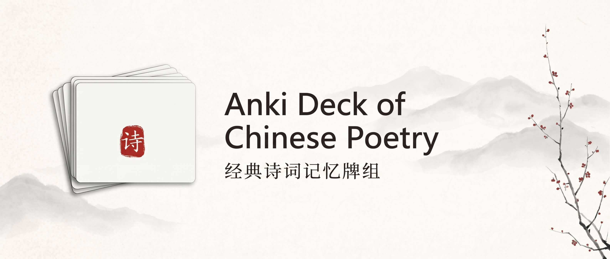

<p align="center">
  
</p>

<p align="center">➡️
  <a href="#快速上手">快速上手</a> ·
  <a href="#get-started">Get started</a> ·
  <a href="#卡片模板">卡片模板</a> ·
  <a href="#card-template">Card template</a> ·
  <a href="#致谢">致谢</a> ·
  <a href="#acknowledgements">Acknowledgements</a>
</p>

## 快速上手

### 项目目标

本仓库是中华诗词 Anki 牌组的内容协作与维护工作区。

如果你只是想下载并使用已制作好的牌组，请前往 [AnkiWeb 牌组页面 (629702782)](https://ankiweb.net/shared/info/629702782) 直接下载导入。

### 参与贡献

非常欢迎大家参与到本项目的共建中！无论是添加新诗词、补充生僻字释义、纠正错别字，还是完善作者小传，都欢迎提交 Pull Request。

#### 1. 文件组织规范

每首诗词以单独的 YAML 文件形式存放在对应朝代与作者的目录下：

```text
[朝代]-[作者]/[题目].yml
```

例如：
- `唐-李白/静夜思.yml`
- `东晋-陶渊明/饮酒 · 结庐在人境.yml`（若含有词牌名或副标题，推荐使用间隔号 ` · ` 分隔）

#### 2. YAML 数据格式规范

文件使用 UTF-8 编码，标准结构如下：

```yaml
---
题目: 饮酒 · 结庐在人境
朝代: 东晋
作者: 陶渊明
诗词:
  - 结庐在人境，而无车马喧。
  - 问君何能尔？心远地自偏。
  - 采菊东篱下，悠然见南山。
  - 山气日夕佳，飞鸟相与还。
  - 此中有真意，欲辨已忘言。
脚注:
  - 庐：简陋的房屋。
  - “见”字读作“xiàn(xiàn)”，通“现”。
诗注: 本诗展现了诗人脱离官场后寄情田园、超然物外的宁静心境。
小传: 陶渊明（约365—427），字元亮，号五柳先生，东晋末期至南朝宋初期诗人、文学家、辞赋家、散文家。
标签:
  - 饮酒
  - 田园
```

**字段说明：**
- `题目`（必填）：诗词篇名。
- `朝代`（必填）：所属朝代（如 `唐`、`宋`、`东晋` 等）。
- `作者`（必填）：作者姓名。
- `诗词`（必填）：诗词内容数组，每行一句。构建时会自动使用 `<br>` 连接。
- `脚注`（选填）：生僻字、词语解释数组。
  - **拼音注音语法**：支持 `汉字(pīnyīn)` 格式（如 `见(xiàn)`），构建脚本会自动将其转换为 `<ruby>见<rp>(</rp><rt>xiàn</rt><rp>)</rp></ruby>` 拼音注音标签。
- `诗注`（选填）：全诗的创作背景、赏析或整体注解。
- `小传`（选填）：作者生平简介。
- `标签`（选填）：用于 Anki 卡片筛选分类的标签数组。

#### 3. 本地构建与验证

本项目使用 Ruby 与 Rake 管理数据构建及代码风格检查：

```bash
# 安装依赖
bundle install

# 运行代码规范检查并生成/更新 chinese-poetry.txt
rake
```

`rake` 任务会自动执行 RuboCop 检查，将所有 YAML 诗词汇总编译为 `chinese-poetry.txt`（供 Anki 批量导入），并校验是否有重复的 GUID。

## Get started

### Aiming

This repository serves as a collaborative workspace for curating and maintaining the Anki deck of Chinese Poetry.

To download and use the compiled deck directly, please visit the [AnkiWeb Deck Page (629702782)](https://ankiweb.net/shared/info/629702782).

### Contributing

Contributions are warmly welcomed! Whether you would like to add new poems, provide footnotes/annotations, fix typos, or improve author biographies, feel free to submit a Pull Request.

#### 1. File Organization

Each poem is stored as an individual YAML file under a directory named after its dynasty and author:

```text
<Dynasty>-<Author>/<Title>.yml
```

Examples:
- `唐-李白/静夜思.yml`
- `东晋-陶渊明/饮酒 · 结庐在人境.yml` (For tune names or subtitles, the middle dot ` · ` is recommended as a delimiter)

#### 2. YAML Schema

Files must be encoded in UTF-8. A standard YAML entry is structured as follows:

```yaml
---
题目: 饮酒 · 结庐在人境
朝代: 东晋
作者: 陶渊明
诗词:
  - 结庐在人境，而无车马喧。
  - 问君何能尔？心远地自偏。
  - 采菊东篱下，悠然见南山。
  - 山气日夕佳，飞鸟相与还。
  - 此中有真意，欲辨已忘言。
脚注:
  - 庐：简陋的房屋。
  - “见”字读作“xiàn(xiàn)”，通“现”。
诗注: 本诗展现了诗人脱离官场后寄情田园、超然物外的宁静心境。
小传: 陶渊明（约365—427），字元亮，号五柳先生，东晋末期至南朝宋初期诗人、文学家、辞赋家、散文家。
标签:
  - 饮酒
  - 田园
```

**Field Descriptions:**
- `题目` (Title, required): Title of the poem.
- `朝代` (Dynasty, required): Dynasty (e.g., `唐` for Tang, `宋` for Song).
- `作者` (Author, required): Author's name.
- `诗词` (Poem Lines, required): Array of verses. Joined with `<br>` tags during build.
- `脚注` (Footnotes, optional): Array of word definitions or pronunciations.
  - **Pinyin Ruby Annotation**: Supports `Character(pīnyīn)` syntax (e.g., `见(xiàn)`), which the build script automatically converts to `<ruby>见<rp>(</rp><rt>xiàn</rt><rp>)</rp></ruby>` HTML tags.
- `诗注` (Poem Notes, optional): Historical context, analysis, or appreciation of the entire poem.
- `小传` (Biography, optional): Brief biography of the poet.
- `标签` (Tags, optional): List of tags for Anki deck categorization.

#### 3. Local Build & Verification

This project uses Ruby and Rake to format data and ensure consistency:

```bash
# Install dependencies
bundle install

# Run code style checks and compile/update chinese-poetry.txt
rake
```

The `rake` task automatically runs RuboCop style checks, compiles all YAML entries into `chinese-poetry.txt` (for Anki importing), and verifies there are no duplicate GUIDs.

## 卡片模板 / Card template

供参考，牌组使用了以下卡片模板及样式：

For your information, the following templates and styles are used in the deck:

### 正面模板 / Front template

```html
<div id="cp-title">《{{题目}}》— {{朝代}}·{{作者}}</div>
```

### 背面模板 / Back template

```html
{{FrontSide}}

<div id="answer" class="cp-hr"></div>

<div id="cp-content">{{诗词}}</div>

<div class="cp-hr">
  <div id="cp-progressbar"></div>
</div>

<div id="cp-footnotes">
  <div>{{脚注}}</div>
  <div>{{诗注}}</div>
  <div>{{小传}}</div>
</div>

<script>
var content = document.getElementById('cp-content')
var contents = content.innerHTML.split('<br>').map(function(line) {
  return '<div class="hidden">' + line + '</div>'
})
content.innerHTML = contents.join('')
var footnotes = document.getElementById('cp-footnotes')
footnotes.classList = 'hidden'

var progressbar = document.getElementById("cp-progressbar")

var clock = {
  index: 0,
  timer: null,
  ticks: -1,
  maxTicks: 35,
  click: false,
  tick: function () {
    if (this.timer) {
      clearTimeout(this.timer)
      this.timer = null
    }

    if (this.ticks > this.maxTicks || this.click === true) {
      content.children[this.index].classList = ''
      this.index += 1
      this.ticks = 0
      this.click = false
      progressbar.style.width = "0%"
    } else {
      this.ticks += 1
      progressbar.style.width = ((this.ticks - 1) / (this.maxTicks - 1)) * 100 + "%"
    }

    if (this.index < contents.length) {
      this.timer = setTimeout(function () { clock.tick() }, 100)
    } else {
      footnotes.classList = ''
      document.getElementById("timer-visual").style.display = "none"
    }
  }
}

var handler = function () {
  if (clock.ticks > 5 && clock.ticks < 30) {
    clock.click = true
    clock.tick()
    clock.ticks = 5
  }
}

document.addEventListener('click', handler)
document.addEventListener('touchstart', handler)

clock.tick()
</script>
```

### 样式 / Styling

```css
html {
  font-size: 16px;
  font-family: -apple-system, BlinkMacSystemFont, San Francisco, Segoe UI, Roboto, Helvetica Neue, sans-serif;
}

.hidden {
  visibility: hidden;
}

.card {
  color: black;
  background-color: white;
  text-align: center;
}

.cp-hr {
  margin: 1rem 0;
  width: 100%;
  height: 1px;
  background-color: #ccc;
}

#cp-title {
  font-size: 1.25rem;
  margin-bottom: 1em;
}

#cp-content {
  margin: 1rem;
  cursor: pointer;
}

#cp-content > div {
  min-height: 1em; /* for blank lines */
}

#cp-progressbar {
  width: 0%;
  height: 100%;
  background: linear-gradient(to right, #f5f5f5, #2c1e1e);
  transition: width 0.1s linear;
}

#cp-footnotes {
  font-size: 1rem;
  text-align: left;
}

#cp-footnotes > div {
  margin-bottom: 1em;
}

#cp-footnotes ruby rt {
  font-size: 0.8rem;
}
```

## 致谢 / Acknowledgements

感谢以下开源项目，为本牌组的制作奠定了基础：

Thanks to the following open-source projects for making this deck possible:

- [`chinese-poetry`](https://github.com/chinese-poetry/chinese-poetry)

更由衷致敬千百年来的先贤诗人，是他们留下的不朽篇章，赋予了这套牌组灵魂与生命：

Our deepest gratitude goes to the great poets throughout the ages, whose timeless verses breathe life and soul into this deck:

<p align="center">
  
</p>
